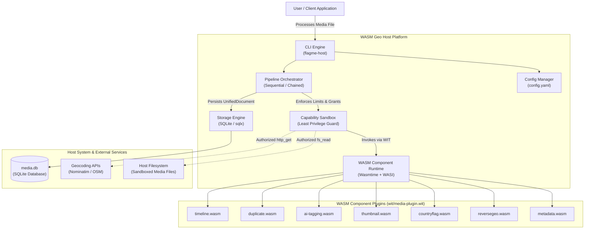

# WASM Geo Host

[](https://www.rust-lang.org/)
[](https://component-model.bytecodealliance.org/)
[](https://wasmtime.dev/)
[](NOTICE)

**WASM Geo Host** is a modular media processing platform written in 100% Rust. It executes image enrichment, geolocation, computer vision tagging, and duplicate detection inside isolated WebAssembly Components using Wasmtime and WASI.

---

<!-- START doctoc generated TOC please keep comment here to allow auto update -->

<details>
<summary>Table of Contents</summary>

- [Architecture (C4 Model)](#architecture-c4-model)
- [Pipeline Execution Workflow](#pipeline-execution-workflow)
- [Included Plugins](#included-plugins)
- [Setup & Prerequisites](#setup-prerequisites)
  - [macOS](#macos)
  - [Linux (Ubuntu / Debian / RHEL)](#linux-ubuntu-debian-rhel)
- [Build & Test](#build-test)
- [Usage](#usage)
  - [1. Configure Capabilities and Pipeline (`config.yaml`)](#1-configure-capabilities-and-pipeline-configyaml)
  - [2. Process Media Files](#2-process-media-files)
    - [Mode 1: In-Process Host Execution](#mode-1-in-process-host-execution)
    - [Mode 2c: Host Subprocess Streaming Supervisor](#mode-2c-host-subprocess-streaming-supervisor)
- [Dual-Mode & Advanced Pipeline Execution Models](#dual-mode-advanced-pipeline-execution-models)
  - [Advanced Pipeline Models](#advanced-pipeline-models)
- [Documentation](#documentation)
- [License & Attribution](#license-attribution)

</details>

<!-- END doctoc generated TOC please keep comment here to allow auto update -->

---

## Architecture (C4 Model)



---

## Pipeline Execution Workflow

Every media file is passed sequentially as a `UnifiedDocument` through the configured plugin pipeline:

```mermaid
flowchart LR
    photo["Input Photo"] --> meta["1. metadata\n(EXIF, IPTC, XMP)"]
    meta --> geo["2. reversegeo\n(Coordinates to City/Region)"]
    geo --> flag["3. countryflag\n(ISO Code to Flag Emoji)"]
    flag --> thumb["4. thumbnail\n(128px, 512px, 1024px)"]
    thumb --> ai["5. ai-tagging\n(MobileNet / CLIP Tags)"]
    ai --> dup["6. duplicate\n(SHA256 & pHash Indexing)"]
    dup --> time["7. timeline\n(Timestamp Conflict Resolution)"]
    time --> db[("8. SQLite Persistence\n(Relational Storage)")]
```



---

## Included Plugins

| Plugin            | Capability Requirements | Description                                                                                                                      |
| ----------------- | ----------------------- | -------------------------------------------------------------------------------------------------------------------------------- |
| **`metadata`**    | `filesystem`            | Lossless extraction of EXIF, IPTC, and XMP tags; preserves all vendor metadata in `raw_tags`.                                    |
| **`reversegeo`**  | `http`, `kv`            | Resolves lat/lon coordinates to country, region, county, and city via offline Natural Earth and online OSM fallback.             |
| **`countryflag`** | _(none)_                | Completely offline ISO-3166 database returning localized country names, Unicode flag emojis (e.g., 🇩🇪), continents, and regions. |
| **`thumbnail`**   | `filesystem`            | Deterministic generation of 128px, 512px, and 1024px image variants for JPEG, PNG, WebP, TIFF, HEIC, and AVIF.                   |
| **`ai-tagging`**  | `filesystem`            | Swappable vision model interface supporting ONNX Runtime, MobileNetV3, CLIP, and OpenCLIP classifiers.                           |
| **`duplicate`**   | `filesystem`, `kv`      | Generates cryptographic SHA256 and perceptual difference hashes (`phash`) to flag duplicate media.                               |
| **`timeline`**    | `filesystem`            | Resolves and normalizes conflicting timestamps (EXIF original vs. XMP authoring vs. filesystem modtime).                         |

---

## Setup & Prerequisites

### macOS

1. **Install Rust**:
   ```bash
   curl --proto '=https' --tlsv1.2 -sSf https://sh.rustup.rs | sh
   ```
2. **Add WASM target & tools**:
   ```bash
   rustup target add wasm32-wasip2
   brew install sqlite
   ```

### Linux (Ubuntu / Debian / RHEL)

1. **Install Rust and build essentials**:
   ```bash
   # Debian / Ubuntu
   sudo apt update && sudo apt install -y build-essential pkg-config libssl-dev sqlite3 curl
   curl --proto '=https' --tlsv1.2 -sSf https://sh.rustup.rs | sh
   ```
2. **Add WASM target**:
   ```bash
   rustup target add wasm32-wasip2
   ```

---

## Build & Test

Build the entire workspace:

```bash
cargo build --all
```

Run the complete test suite (covering all SDD acceptance criteria):

```bash
cargo test --all
```

To compile individual plugins as native WebAssembly Components (`wasm32-wasip2`):

```bash
cargo build --package flagme-plugin-metadata --target wasm32-wasip2 --release
cargo build --package flagme-plugin-reversegeo --target wasm32-wasip2 --release
cargo build --package flagme-plugin-countryflag --target wasm32-wasip2 --release
cargo build --package flagme-plugin-thumbnail --target wasm32-wasip2 --release
cargo build --package flagme-plugin-ai-tagging --target wasm32-wasip2 --release
cargo build --package flagme-plugin-duplicate --target wasm32-wasip2 --release
cargo build --package flagme-plugin-timeline --target wasm32-wasip2 --release
```

---

## Usage

### 1. Configure Capabilities and Pipeline (`config.yaml`)

Edit `config.yaml` to specify which plugins are enabled, their execution order, and their granted capabilities:

```yaml
database_path: 'media.db'

resource_limits:
  max_memory_bytes: 268435456 # 256 MB
  timeout_ms: 10000 # 10s

pipeline:
  - metadata
  - reversegeo
  - countryflag
  - thumbnail
  - ai-tagging
  - duplicate
  - timeline

plugins:
  metadata:
    enabled: true
    capabilities: ['filesystem']
  reversegeo:
    enabled: true
    capabilities: ['http', 'kv']
  countryflag:
    enabled: true
    capabilities: []
  thumbnail:
    enabled: true
    capabilities: ['filesystem']
  ai-tagging:
    enabled: true
    capabilities: ['filesystem']
  duplicate:
    enabled: true
    capabilities: ['filesystem', 'kv']
  timeline:
    enabled: true
    capabilities: ['filesystem']
```

### 2. Process Media Files

#### Mode 1: In-Process Host Execution

Runs the pipeline within the `flagme-host` process, sharing memory safely across plugins:

```bash
cargo run --bin flagme-host -- process Examples/sample.jpg --config config.yaml
```

The CLI outputs the enriched `UnifiedDocument` as structured JSON, while concurrently persisting records to the SQLite database `media.db`.

#### Mode 2c: Host Subprocess Streaming Supervisor

Spawns each WASM plugin as an isolated child process, streaming JSON between them via stdin/stdout:

```bash
cargo run --bin flagme-host -- stream Examples/sample.jpg --config config.yaml
```

---

## Dual-Mode & Advanced Pipeline Execution Models

Every plugin in `plugins/*` supports **Dual-Mode** compilation:

1. **Library Component (`cdylib`/`rlib`)**: Used for high-throughput, in-process embedding inside `flagme-host`.
2. **Standalone WASI CLI Binary (`bin`)**: Executable directly via `wasmtime run -S cli-exit-with-code <plugin>.wasm`.

### Advanced Pipeline Models

- **[Model 2a: Unix CLI Streaming Pipeline](docs/pipeline_unix_pipes.md)** — Pipe plugins together using standard shell pipes (`|`):
  ```bash
  wasmtime run -S cli-exit-with-code --dir Examples::/media \
      target/wasm32-wasip2/release/flagme-plugin-metadata.wasm /media/sample.jpg \
    | wasmtime run -S cli-exit-with-code target/wasm32-wasip2/release/flagme-plugin-reversegeo.wasm \
    | wasmtime run -S cli-exit-with-code target/wasm32-wasip2/release/flagme-plugin-countryflag.wasm \
    | jq .
  ```
- **[Model 2b: Component Composition](docs/pipeline_component_composition.md)** — Statically compose plugins into a single component (`wac compose` or `wasm-tools compose`) for zero-copy memory execution.
- **[Model 2c: Host Streaming Supervisor](docs/pipeline_host_supervisor.md)** — Let `flagme-host stream` supervise and monitor sandboxed child processes.

---

## Documentation

- [Build Instructions](docs/build-instructions.md)
- [Deployment Guide](docs/deployment-guide.md)
- [Plugin Development Guide](docs/plugin-development-guide.md)
- [Pipeline Model 2a: Unix CLI Streaming](docs/pipeline_unix_pipes.md)
- [Pipeline Model 2b: Component Composition](docs/pipeline_component_composition.md)
- [Pipeline Model 2c: Host Streaming Supervisor](docs/pipeline_host_supervisor.md)
- [Verfassung & SDD Spezifikationen](constitution.md)
- [GitHub Feature Specification Template](.github/ISSUE_TEMPLATE/feature_spec.md)

---

## License & Attribution

Licensed under the MIT or Apache 2.0 license. See [NOTICE](NOTICE) for third-party component acknowledgments.
