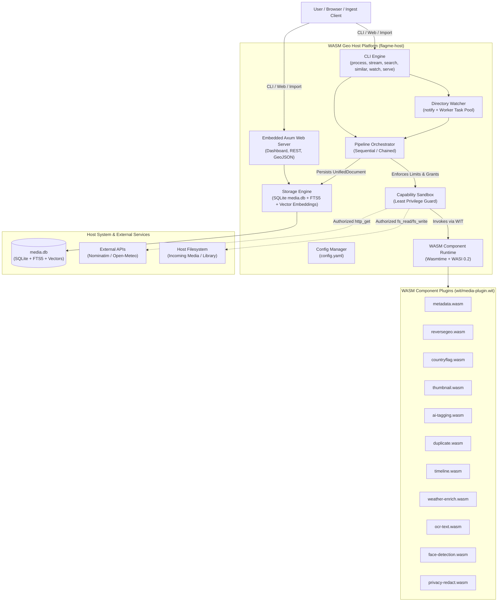

# WASM Geo Host

[](https://www.rust-lang.org/)
[](https://component-model.bytecodealliance.org/)
[](https://wasmtime.dev/)
[](NOTICE)

**WASM Geo Host** is a production-ready media processing and ingestion platform written in 100% Rust. It executes image enrichment, geolocation, computer vision tagging, duplicate detection, weather context, OCR, face detection, and privacy redaction inside isolated WebAssembly Components using Wasmtime and WASI 0.2.

---

<!-- START doctoc generated TOC please keep comment here to allow auto update -->

<details>
<summary>Table of Contents</summary>

- [Architecture (C4 Model)](#architecture-c4-model)
- [Pipeline Execution Workflow](#pipeline-execution-workflow)
- [Included Plugins (11 WASI Plugins)](#included-plugins-11-wasi-plugins)
- [Setup & Prerequisites](#setup-prerequisites)
  - [macOS](#macos)
  - [Linux (Ubuntu / Debian / RHEL)](#linux-ubuntu-debian-rhel)
- [Build & Test](#build-test)
- [Usage & CLI Commands](#usage-cli-commands)
  - [1. Configure Capabilities and Pipeline (`config.yaml`)](#1-configure-capabilities-and-pipeline-configyaml)
  - [2. Hardware & Environment Profiles (Docker vs. Mac Studio 32GB)](#2-hardware-environment-profiles-docker-vs-mac-studio-32gb)
    - [A. Docker / Container Profile (`config.docker.yaml`)](#a-docker-container-profile-configdockeryaml)
    - [B. Mac Studio M-Series / High-End Workstation Profile (`config.mac-studio.yaml`)](#b-mac-studio-m-series-high-end-workstation-profile-configmac-studioyaml)
  - [3. Single Media Processing (`flagme-host process`)](#3-single-media-processing-flagme-host-process)
  - [3b. Streaming Mode (`flagme-host stream`)](#3b-streaming-mode-flagme-host-stream)
  - [4. Full-Text Search FTS5 (`flagme-host search`)](#4-full-text-search-fts5-flagme-host-search)
  - [5. Vector Similarity Search (`flagme-host similar`)](#5-vector-similarity-search-flagme-host-similar)
  - [6. Directory Watcher & Batch Ingest (`flagme-host watch`)](#6-directory-watcher-batch-ingest-flagme-host-watch)
  - [7. Embedded Web Dashboard & REST/GeoJSON API (`flagme-host serve`)](#7-embedded-web-dashboard-restgeojson-api-flagme-host-serve)
    - [REST & GeoJSON Endpoints:](#rest-geojson-endpoints)
- [Dual-Mode & Advanced Pipeline Execution Models](#dual-mode-advanced-pipeline-execution-models)
  - [Advanced Pipeline Models](#advanced-pipeline-models)
- [Documentation & Spec-Driven Development (SDD)](#documentation-spec-driven-development-sdd)
- [License & Attribution](#license-attribution)

</details>

<!-- END doctoc generated TOC please keep comment here to allow auto update -->

---

## Architecture (C4 Model)



---

## Pipeline Execution Workflow

Every media file is passed as a `UnifiedDocument` through the configured plugin pipeline:


---

## Included Plugins (11 WASI Plugins)

| Plugin | Capability Requirements | Description |
| :--- | :--- | :--- |
| **`metadata`** | `filesystem` | Lossless extraction of EXIF, IPTC, and XMP tags; preserves all vendor metadata in `raw_tags`. |
| **`reversegeo`** | `http`, `kv` | Resolves lat/lon coordinates to country, region, county, and city via an embedded offline GeoNames gazetteer (162k places, CC BY 4.0) and an optional online OSM/Nominatim fallback. |
| **`countryflag`** | _(none)_ | Completely offline ISO-3166 database returning localized country names, Unicode flag emojis (e.g. 🇩🇪), continents, and regions. |
| **`thumbnail`** | `filesystem` | Scales JPEG, PNG, WebP, TIFF and GIF to 128px, 512px and 1024px variants in pure Rust (aspect ratio and EXIF orientation kept). HEIC/AVIF are not supported yet. |
| **`ai-tagging`** | `filesystem` | **Experimental, disabled by default.** Tags, description and embeddings from an exchangeable `VisionModel`; no model is built in yet ([ADR 0002](docs/adr/0002-plugins-without-engine-no-output.md)). |
| **`duplicate`** | `filesystem`, `kv` | Generates cryptographic SHA256 and perceptual difference hashes (`phash`) to detect duplicates. |
| **`timeline`** | `filesystem` | Resolves and normalizes conflicting timestamps (EXIF original vs. XMP authoring vs. filesystem modtime). |
| **`weather-enrich`** | `http`, `kv` | Historical weather enrichment via Open-Meteo API (temperature, WMO weather codes, weather emojis, humidity). |
| **`ocr-text`** | `filesystem` | **Experimental, disabled by default.** Text regions from an exchangeable `OcrEngine`, indexed into full-text search; no engine is built in yet ([ADR 0002](docs/adr/0002-plugins-without-engine-no-output.md)). |
| **`face-detection`** | `filesystem` | **Experimental, disabled by default.** Faces, bounding boxes and landmarks from an exchangeable `FaceDetector`; no detector is built in yet ([ADR 0002](docs/adr/0002-plugins-without-engine-no-output.md)). |
| **`privacy-redact`** | `filesystem` | Privacy sanitization: visual obfuscation of detected faces/text (pixelate/blur), EXIF serial stripping, and GPS coordinate fuzzing. |

---

## Setup & Prerequisites

### macOS

1. **Install Rust**:
   ```bash
   curl --proto '=https' --tlsv1.2 -sSf https://sh.rustup.rs | sh
   ```
2. **Add WASM target & tools**:
   ```bash
   rustup target add wasm32-wasip2
   brew install sqlite
   ```

### Linux (Ubuntu / Debian / RHEL)

1. **Install Rust and build essentials**:
   ```bash
   # Debian / Ubuntu
   sudo apt update && sudo apt install -y build-essential pkg-config libssl-dev sqlite3 curl ca-certificates  # curl only for rustup; ca-certificates for HTTPS of the http capability
   curl --proto '=https' --tlsv1.2 -sSf https://sh.rustup.rs | sh
   ```
2. **Add WASM target**:
   ```bash
   rustup target add wasm32-wasip2
   ```

---

## Build & Test

Build the entire workspace:

```bash
cargo build --all
```

Build everything for a release (sdd gates, tests, host, plugin components, WASI and native plugin CLIs, packages in `dist/packages`) with `make release`; `make help` lists the single steps (`make host`, `make components`, …).

Compile all plugins to WebAssembly Components (`wasm32-wasip2`, `media-plugin` world). `flagme-host` loads plugins **only** from these components ([ADR 0003](docs/adr/0003-wasm-component-execution.md)); `plugin_dir` in `config.yaml` points at the output directory `target/wasm32-wasip2/release`:

```bash
cargo build --release --target wasm32-wasip2 --lib --features component \
  -p flagme-plugin-metadata -p flagme-plugin-reversegeo -p flagme-plugin-countryflag \
  -p flagme-plugin-thumbnail -p flagme-plugin-ai-tagging -p flagme-plugin-duplicate \
  -p flagme-plugin-timeline -p flagme-plugin-weather-enrich -p flagme-plugin-ocr-text \
  -p flagme-plugin-face-detection -p flagme-plugin-privacy-redact
```

The result is `target/wasm32-wasip2/release/flagme_plugin_<name>.wasm` per plugin. Without `--features component` the same command builds plain libraries, which the host rejects.

Run the complete test suite; the host tests build the components themselves (same command as above) and run against them:

```bash
cargo test --workspace
```

---

## Usage & CLI Commands

### 1. Configure Capabilities and Pipeline (`config.yaml`)

Edit `config.yaml` to specify which plugins are enabled, execution order, and granted sandbox permissions. Each enabled plugin is loaded from `plugins.<name>.path` if set, else from `<plugin_dir>/flagme_plugin_<name>.wasm` (`-` → `_`); a missing component stops the host. `resource_limits` cap the linear memory (`max_memory_bytes`) and run time (`timeout_ms`) of every plugin call; `plugins.<name>.resource_limits` replaces either value for one plugin (higher or lower), missing fields inherit the global value, and an invalid value or unknown key is reported as a warning and falls back to the global value. Compiled components are cached in `component_cache_dir` ([ADR 0004](docs/adr/0004-component-cache.md)), so later starts skip compilation; the host creates the directory with mode `0700` and uses it only if it is a real directory owned by the host user that neither group nor others can write; otherwise it warns and compiles on every start. `component_cache: false` turns the cache off:

```yaml
database_path: 'media.db'
plugin_dir: 'target/wasm32-wasip2/release' # components: flagme_plugin_<name>.wasm
component_cache: true # default
component_cache_dir: 'cache/components' # default, relative to the working directory

resource_limits:
  max_memory_bytes: 268435456 # 256 MB
  timeout_ms: 10000 # 10s

pipeline:
  - metadata
  - reversegeo
  - countryflag
  - thumbnail
  - ai-tagging
  - duplicate
  - timeline
  - weather-enrich
  - ocr-text
  - face-detection
  - privacy-redact

plugins:
  metadata:
    enabled: true
    capabilities: ['filesystem']
  reversegeo:
    enabled: true
    capabilities: ['http', 'kv']
  countryflag:
    enabled: true
    capabilities: []
  thumbnail:
    enabled: true
    capabilities: ['filesystem']
    resource_limits: # optional, overrides the global values for this plugin
      max_memory_bytes: 1073741824 # 1 GB
      timeout_ms: 30000
  ai-tagging:
    enabled: true
    capabilities: ['filesystem']
  duplicate:
    enabled: true
    capabilities: ['filesystem', 'kv']
  timeline:
    enabled: true
    capabilities: ['filesystem']
  weather-enrich:
    enabled: true
    capabilities: ['http', 'kv']
  ocr-text:
    enabled: true
    capabilities: ['filesystem']
  face-detection:
    enabled: true
    capabilities: ['filesystem']
  privacy-redact:
    enabled: true
    capabilities: ['filesystem']
```

---

### 2. Hardware & Environment Profiles (Docker vs. Mac Studio 32GB)

The platform includes production-ready configuration profiles tailored for different hardware tiers:

#### A. Docker / Container Profile (`config.docker.yaml`)
Designed for CPU-constrained container environments (e.g. 512 MB – 2 GB RAM limit per container).
- **AI tagging, OCR, face detection**: disabled (experimental, no engine built in — [ADR 0002](docs/adr/0002-plugins-without-engine-no-output.md)).
- **Memory Limit**: 512 MB per sandbox instance.

```bash
cargo run -p flagme-host -- process /media/photo.jpg --config config.docker.yaml
```

#### B. Mac Studio M-Series / High-End Workstation Profile (`config.mac-studio.yaml`)
Designed for Apple Silicon workstations with 32 GB+ Unified Memory (leveraging Metal / MPS acceleration where available).
- **AI tagging, OCR, face detection**: disabled (experimental, no engine built in — [ADR 0002](docs/adr/0002-plugins-without-engine-no-output.md)).
- **Memory Limit**: 4 GB per sandbox instance; supports 2048px high-fidelity thumbnail generation.

```bash
cargo run -p flagme-host -- process /media/photo.jpg --config config.mac-studio.yaml
```

---

### 3. Single Media Processing (`flagme-host process`)

Processes a single media file through the configured pipeline of Wasm components and stores the result in `media.db`. Every plugin call runs in a fresh Wasmtime store without ambient authority (no preopened directories, environment, stdin or sockets); file, HTTP, KV and secret access goes only through the capabilities granted in `config.yaml`:

```bash
cargo run -p flagme-host -- process Examples/sample.jpg --config config.yaml
```

**Logging:** host and plugin messages go to **stderr** (with the plugin name), the document JSON to **stdout**. The level comes from `RUST_LOG` (default `warn`):

```bash
RUST_LOG=info cargo run -p flagme-host -- process photo.jpg --config config.yaml 2>run.log >doc.json
```

---

### 3b. Streaming Mode (`flagme-host stream`)

Runs the same embedded component pipeline as `process` (one store per stage) and prints the final document; no external `wasmtime` CLI is needed. See [docs/pipeline_host_supervisor.md](docs/pipeline_host_supervisor.md) for a real example output:

```bash
cargo run -p flagme-host -- stream Examples/sample.jpg --config config.yaml
```

---

### 4. Full-Text Search FTS5 (`flagme-host search`)

Queries the built-in SQLite FTS5 full-text index across AI tags, locations, country, camera model, description, and OCR text with BM25 ranking:

```bash
cargo run -p flagme-host -- search "Berlin Sony sunset" --config config.yaml
```

---

### 5. Vector Similarity Search (`flagme-host similar`)

Finds similar photos using cosine similarity ranking over stored 512-D embedding vectors. Embeddings come from the `ai-tagging` vision model; without one (default, [ADR 0002](docs/adr/0002-plugins-without-engine-no-output.md)) no embeddings are stored and `similar` finds nothing:

```bash
cargo run -p flagme-host -- similar "doc_photo_1" --limit 10 --config config.yaml
```

---

### 6. Directory Watcher & Batch Ingest (`flagme-host watch`)

Runs a real-time event-driven directory ingestion daemon (using `notify`) with concurrent worker task pools, duplicate skipping, and automatic target directory organization:

```bash
cargo run -p flagme-host -- watch /media/import/ \
  --target-dir /media/library/ \
  --organize-by "{year}/{month}/{country}/{city}" \
  --workers 4 \
  --config config.yaml
```

`{year}`/`{month}` come from the capture time (`timeline.taken_at`). Photos without a capture time go to `Unknown_Year/00/…` (missing location: `Unknown_Country`/`Unknown_City`); the import time is never used as capture time.

---

### 7. Embedded Web Dashboard & REST/GeoJSON API (`flagme-host serve`)

Launches the embedded HTTP web server powered by Axum with an interactive Leaflet world map, gallery view, full-text search, and REST/GeoJSON endpoints:

```bash
cargo run -p flagme-host -- serve --port 8080 --bind 0.0.0.0 --config config.yaml
```

Open your browser at `http://localhost:8080` to view the media dashboard.

#### REST & GeoJSON Endpoints:
- `GET /api/photos?page=1&limit=50`: Paginated list of unified media documents.
- `GET /api/photos/:id`: Detailed `UnifiedDocument` JSON payload.
- `GET /api/photos/:id/thumbnail/:size`: Cached thumbnail image stream with HTTP `ETag` and `Cache-Control`.
- `GET /api/map/markers`: GeoJSON `FeatureCollection` containing all geotagged photos with GPS Point coordinates and metadata.
- `GET /api/search?q=:query`: FTS5 full-text search API.

---

## Dual-Mode & Advanced Pipeline Execution Models

Every plugin in `plugins/*` supports **Dual-Mode** compilation:

1. **Wasm Component (`cdylib`, feature `component`)**: Exports the `media-plugin` world of [`wit/media-plugin.wit`](wit/media-plugin.wit) via `flagme_sdk::export_plugin!`; `flagme-host` loads it into its embedded Wasmtime runtime with capabilities and resource limits. Plugin crates are not linked into the host.
2. **Standalone WASI CLI Binary (`bin`)**: Executable directly via `wasmtime run -S cli-exit-with-code <plugin>.wasm` (built without the `component` feature; uses its own standalone capabilities, not the host sandbox).

### Advanced Pipeline Models

- **[Model 2a: Unix CLI Streaming Pipeline](docs/pipeline_unix_pipes.md)** — Pipe plugins together using standard shell pipes (`|`):
  ```bash
  wasmtime run -S cli-exit-with-code --dir Examples::/media \
      target/wasm32-wasip2/release/flagme-plugin-metadata.wasm /media/sample.jpg \
    | wasmtime run -S cli-exit-with-code target/wasm32-wasip2/release/flagme-plugin-reversegeo.wasm \
    | wasmtime run -S cli-exit-with-code target/wasm32-wasip2/release/flagme-plugin-countryflag.wasm \
    | jq .
  ```
- **[Model 2b: Component Composition](docs/pipeline_component_composition.md)** — Statically compose plugins into a single component (`wac compose` or `wasm-tools compose`) for zero-copy memory execution.
- **[Model 2c: `flagme-host stream`](docs/pipeline_host_supervisor.md)** — The embedded component runtime of the host, with capabilities, settings and resource limits from `config.yaml`.

---

## Documentation & Spec-Driven Development (SDD)

This repository strictly adheres to **Spec-Driven Development (SDD)** with zero-tolerance for untested code or specification drift:

- [Project Constitution](constitution.md)
- [Agent Guidelines (AGENTS.md)](AGENTS.md)
- [Build Instructions](docs/build-instructions.md)
- [Deployment Guide](docs/deployment-guide.md)
- [Plugin Development Guide](docs/plugin-development-guide.md)
- [Pipeline Model 2a: Unix CLI Streaming](docs/pipeline_unix_pipes.md)
- [Pipeline Model 2b: Component Composition](docs/pipeline_component_composition.md)
- [Pipeline Model 2c: `flagme-host stream`](docs/pipeline_host_supervisor.md)
- **PRD Specifications**: `docs/prd/*.md`
- **Technical Design Specs**: `docs/design/*.md`
- **Implementation Plans**: `docs/plans/*.md`

---

## License & Attribution

Licensed under the MIT or Apache 2.0 license. See [NOTICE](NOTICE) for third-party component acknowledgments.
