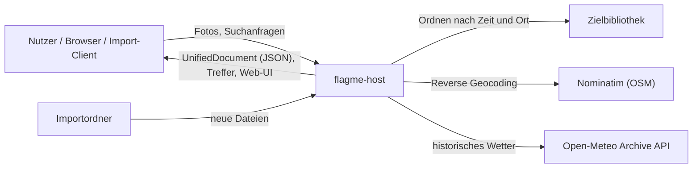
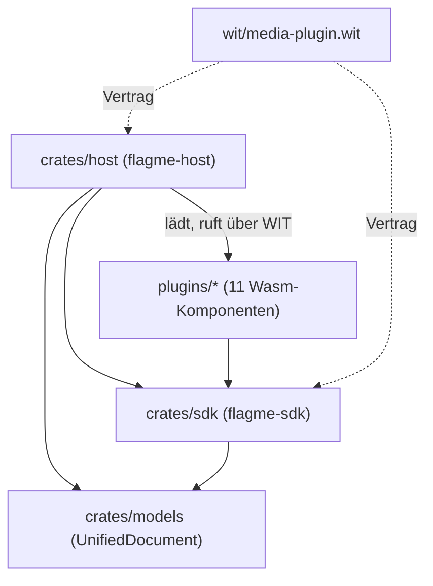
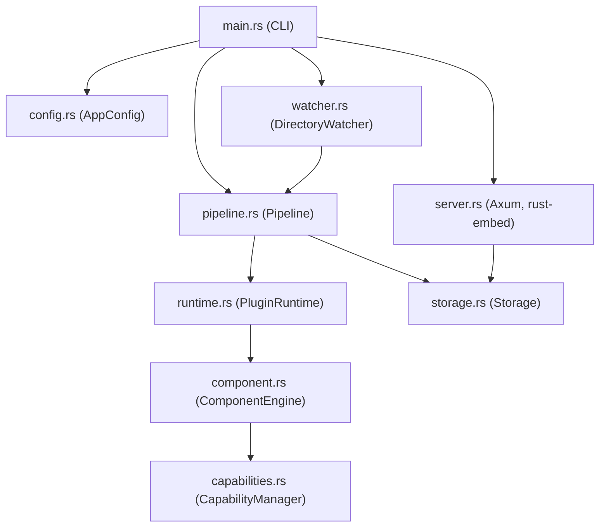
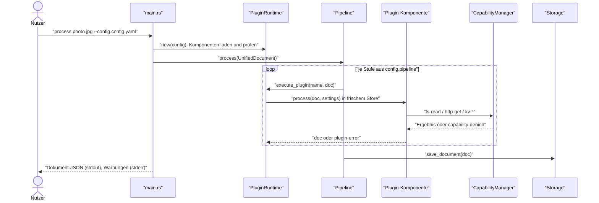
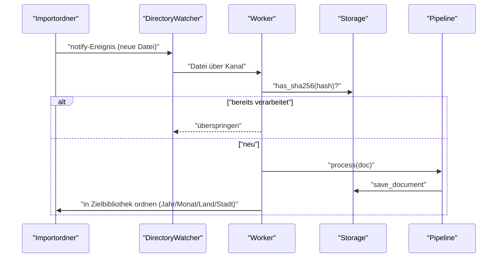
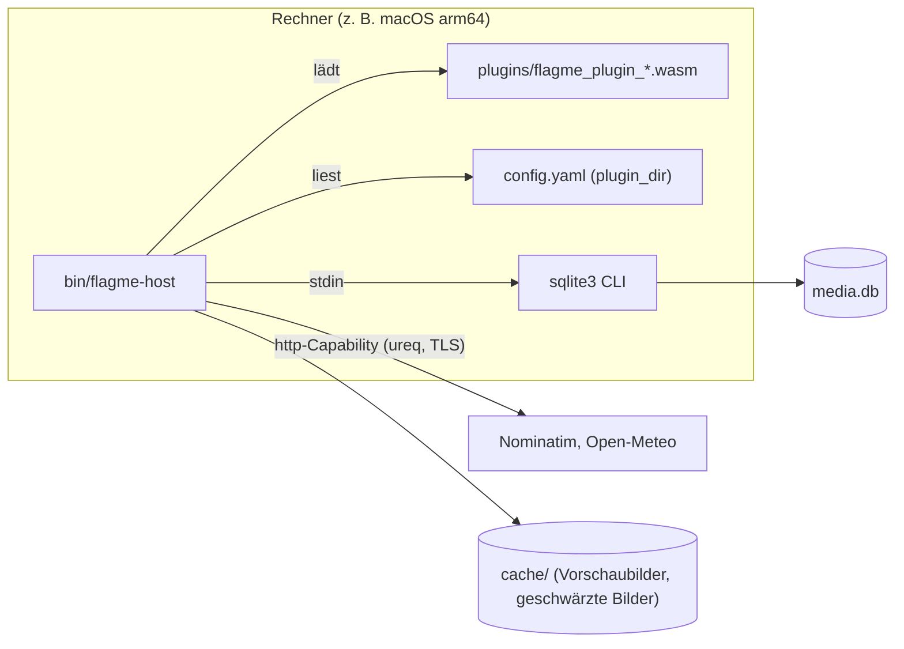

<!--
Gliederung: arc42-Template 9.1, © Dr. Peter Hruschka, Dr. Gernot Starke und Mitwirkende, https://arc42.org
Lizenz: Creative Commons Attribution-ShareAlike 4.0 International (CC BY-SA 4.0), https://creativecommons.org/licenses/by-sa/4.0/
Geändert: deutsche Übersetzung der Gliederung, Hilfetexte gekürzt (SDD Studio, ADR 0006). Der Inhalt, den das Projekt einträgt, gehört dem Projekt.
-->

# Architekturdokumentation — wasm_geo-host

Gliederung nach dem [arc42](https://arc42.org)-Template 9.1 (© Dr. Peter Hruschka, Dr. Gernot Starke und Mitwirkende), lizenziert unter [CC BY-SA 4.0](https://creativecommons.org/licenses/by-sa/4.0/); deutsche Fassung der Gliederung. `release:` im Kopf nennt den Stand, den diese Seite beschreibt. Diagramme in [Mermaid](https://mermaid.js.org).

# Einführung und Ziele {#section-introduction-and-goals}

## Aufgabenstellung {#_requirements_overview}

WASM Geo Host (`flagme-host`) ist eine erweiterbare Medienverarbeitungsplattform in Rust. Sie reicht Fotos als `UnifiedDocument` durch eine konfigurierbare Pipeline von Plugins und speichert das Ergebnis in SQLite (Quelle: `docs/archive/prd/wasm-geo-host.md:26`).

Die Plugins in Release 0.2.0 und ihre Aufgaben (Quelle: `README.md:127-137`):

| Plugin | Aufgabe |
|---|---|
| `metadata` | EXIF, IPTC, XMP |
| `reversegeo` | Ortsnamen offline (eingebettetes GeoNames-Ortsverzeichnis, nach 0.2.0) und online |
| `countryflag` | ISO-3166-Daten |
| `thumbnail` | Vorschaubilder |
| `duplicate` | SHA-256 und dHash |
| `timeline` | Aufnahmezeit |
| `weather-enrich` | historisches Wetter |
| `privacy-redact` | Schwärzung, GPS-Unschärfe, Seriennummern |
| `ai-tagging`, `ocr-text`, `face-detection` | Engine-Schnittstellen, experimentell und deaktiviert (ADR 0002) |

Dazu kommen Volltext- und Ähnlichkeitssuche, ein Verzeichnis-Watcher und eine eingebettete Web-Oberfläche (Quelle: `CHANGELOG.md`, Abschnitt 0.2.0 *Added*).

Bindend sind die Regeln der Verfassung (`constitution.md`).

## Qualitätsziele {#_quality_goals}

Die Priorität hat der Maintainer festgelegt (Quelle: Entscheidung des Maintainers vom 2026-11-26; noch keine `QA-<n>` in den PRDs).

| Priorität | Qualitätsziel | Begründung (Quelle) |
|---|---|---|
| 1 | **Sicherheit und Isolation der Plugins** | Plugins haben keine Ambient Authority. Jeder Ressourcenzugriff braucht einen Grant je Plugin. Gäste laufen mit Speicher- und Zeitgrenzen (`constitution.md:18-20`, ADR 0003). |
| 2 | **Korrektheit der Daten (nichts Erfundenes)** | Keine Mocks oder Stubs im Produktionspfad (`constitution.md:25`). Nicht bestimmbare Werte bleiben leer, mit Warnung (ADR 0002). `raw_tags` bleibt das Original (ADR 0001). |
| 3 | **Erweiterbarkeit durch Plugins** | Die Schnittstellen stehen in WIT. Plugins hängen nur vom SDK ab und kennen einander nicht (`constitution.md:12-13`). |
| 4 | **Nachvollziehbarkeit (Logs, Tests je Kriterium)** | Logs gehen auf stderr, mit dem Plugin-Namen (`docs/archive/prd/wasm-geo-host.md:61`). Jeder Test nennt sein Akzeptanzkriterium, und `sdd gate pre-merge` läuft vor jedem Merge (`constitution.md:26-27`). |

## Stakeholder {#_stakeholders}

| Rolle | Erwartung |
|---|---|
| Betreiber von `flagme-host` | verlassen sich auf die Sandbox und auf die Grants in `config.yaml` (Quelle: `docs/archive/prd/wasm-component-runtime.md:47`) |
| Plugin-Entwickler | implementieren nur `Plugin` und führen ihr Modul isoliert aus (Quelle: `docs/archive/prd/wasm-component-runtime.md:48`, `docs/archive/prd/wasm-geo-host.md:31`) |
| Entwickler von Medienplattformen und Geodiensten | wollen sichere Bildanalyse- und Tagging-Pipelines (Quelle: `docs/archive/prd/wasm-geo-host.md:30`) |
| Endanwender und Fotografen | wollen ihre Bibliothek im Browser sehen und einen Importordner automatisch verarbeiten lassen (Quelle: `docs/archive/prd/embedded-web-ui.md:27`, `docs/archive/prd/directory-watcher.md:27`) |
| Integratoren | wollen Metadaten über REST und GeoJSON abrufen (Quelle: `docs/archive/prd/embedded-web-ui.md:28`) |
| Fotografen, Verlage, Plattformbetreiber | wollen Bilder vor der Veröffentlichung DSGVO-konform anonymisieren (Quelle: `docs/archive/prd/privacy-redact.md:25`) |

# Randbedingungen {#section-architecture-constraints}

**Schichten** (Quelle: `constitution.md:11-14`)
- Es gibt die Schichten Host (`crates/host`), SDK (`crates/sdk`), Modelle (`crates/models`) und Plugins (`plugins/*`).
- Plugins laufen als Wasm-Komponenten mit WIT-Schnittstellen.
- Plugins hängen nur von SDK und Modellen ab.
- Daten fließen als `UnifiedDocument` durch die Pipeline.

**Security** (Quelle: `constitution.md:18-20`)
- Capability-based Security ohne Ambient Authority.
- Grants je Plugin in der Host-Konfiguration.
- Grenzen für Speicher und Laufzeit.

**Strikte Regeln** (Quelle: `constitution.md:24-27`)
- Produktionscode in sicherem, idiomatischem Rust.
- Keine Mocks, Stubs oder Pseudocode im Produktionspfad.
- Jeder Test nennt sein Akzeptanzkriterium.
- `sdd gate pre-merge` muss vor jedem Merge fehlerfrei sein.

**Prozess**
- Spec-Driven Development: Idee → PRD → Tech Spec → Plan → Tests → Umsetzung → Gate → Merge → Release → Archiv. Baseline, ADR-Lock und ADR-Entscheidungen trifft der Mensch (Quelle: `AGENTS.md`, Abschnitt *Ablauf*).

**Technik**
- Zielplattform der Plugins ist `wasm32-wasip2`. Sie werden mit dem Feature `component` gebaut (Quelle: `README.md:180-190`).
- Das Bauen braucht Rust 1.97 oder neuer, weil Wasmtime 51 das verlangt (Quelle: `CHANGELOG.md`, Abschnitt 0.2.0 *Breaking*).
- Zur Laufzeit ruft der Host das Kommandozeilenprogramm `sqlite3` (Speicher) auf. Die Capability `http` lief in 0.2.0 über ein externes Programm; nach 0.2.0 (unveröffentlicht) läuft sie im Host-Prozess mit `ureq` und den System-Zertifikaten (Quelle: `crates/host/src/storage.rs:66`, ADR 0007).

**Nicht-Ziele** (Quelle: `docs/archive/prd/wasm-geo-host.md:47-48`)
- Kein Betrieb verteilt im Cluster.
- Keine proprietären Cloud-APIs im Kern.

# Kontextabgrenzung {#section-context-and-scope}

## Fachlicher Kontext {#_business_context}

Nutzer übergeben Fotos und bekommen angereicherte Dokumente, Suchergebnisse und eine Karten- und Galerieansicht zurück. Externe Dienste liefern Ortsnamen und Wetterdaten (Quelle: `README.md`, Diagramm *Architecture (C4 Model)*; `docs/archive/design/weather-enrich.md:20-35`).

## Technischer Kontext {#_technical_context}

| Partner | Kanal | Quelle |
|---|---|---|
| Nutzer (CLI) | `flagme-host process\|stream\|search\|similar\|watch\|serve`; Dokument-JSON auf stdout, Logs auf stderr | `crates/host/src/main.rs:30-35`, `docs/archive/prd/wasm-geo-host.md:61` |
| Browser, Integratoren | HTTP: `/api/photos`, `/api/photos/:id`, `/api/photos/:id/thumbnail/:size`, `/api/map/markers` (GeoJSON), `/api/search` | `crates/host/src/server.rs:73-77` |
| Dateisystem | Medien lesen, Vorschaubilder und geschwärzte Bilder schreiben, Importordner überwachen (`notify`) | `crates/host/src/capabilities.rs`, `crates/host/src/watcher.rs:172` |
| Nominatim, Open-Meteo | HTTPS im Host-Prozess über `ureq` (nach 0.2.0; 2 s, 1 MiB, 5 Weiterleitungen, System-Zertifikate, Proxy aus der Umgebung), nur für Plugins mit dem Grant `http` | `crates/host/src/capabilities.rs`, ADR 0007 |
| SQLite (`media.db`) | `sqlite3`-CLI über stdin | `crates/host/src/storage.rs:63-66` |

# Lösungsstrategie {#section-solution-strategy}

- **Plugins als eingebettete Wasm-Komponenten** (ADR 0003):
  - Wasmtime ist im Host eingebettet.
  - Der WIT-Vertrag ist typisiert und bildet `UnifiedDocument` vollständig ab.
  - Jeder Plugin-Aufruf bekommt einen frischen `Store`.
  - Es gibt keinen nativen Rückfall.
- **Capabilities statt Ambient Authority:** Datei-, HTTP-, KV- und Secret-Zugriffe gehen nur über die Imports `host-capabilities`. Der `CapabilityManager` prüft jeden Aufruf gegen die Grants des Plugins (Quelle: `wit/media-plugin.wit:172`, `crates/host/src/capabilities.rs`).
- **Ein Dokumentenmodell:** Alle Stufen lesen und schreiben `UnifiedDocument` (Quelle: `constitution.md:14`, `crates/models/src/lib.rs`).
- **Ehrliche Lücken:** Plugins ohne echte Engine liefern nichts. Nicht bestimmbare Werte bleiben `None` mit einer Warnung (ADR 0002). `raw_tags` bleibt das verlustfreie Original (ADR 0001).
- **Konfiguration statt Code:**
  - `config.yaml` legt fest: Pipeline-Reihenfolge, `enabled`, Grants, `settings` je Plugin, `resource_limits` (global und, nach 0.2.0, je Plugin), `plugin_dir`.
  - Die Settings liest das SDK nach gemeinsamen Regeln aus (Quelle: `docs/archive/design/plugin-settings.md:17-35`, `crates/host/src/config.rs`).

# Bausteinsicht {#section-building-block-view}

## Whitebox Gesamtsystem {#_whitebox_overall_system}

| Baustein | Verantwortung | Quelle |
|---|---|---|
| `crates/host` | CLI, Konfiguration, Komponenten-Runtime, Capabilities, Pipeline, Speicher, Watcher, Web-Server | `crates/host/src/lib.rs` |
| `crates/sdk` | `Plugin`-Trait, `HostCapabilities`, `PluginContext`, Settings-Leser, Komponenten-Adapter (`export_plugin!`) | `crates/sdk/src/lib.rs`, `crates/sdk/src/component.rs:77` |
| `crates/models` | `UnifiedDocument` und Unterstrukturen (Serde) | `crates/models/src/lib.rs` |
| `wit/` | Paket `wasmgeohost:media@0.2.0`: Interfaces `types`, `host-capabilities`, Welt `media-plugin` | `wit/media-plugin.wit:1`, `:5`, `:172`, `:193` |
| `plugins/*` | je ein Verarbeitungsschritt; hängt nur vom SDK ab | `constitution.md:13`, `README.md:127-137` |

## Ebene 2 {#_level_2}

Innere Struktur von `crates/host`:

| Baustein | Verantwortung | Quelle |
|---|---|---|
| `PluginRuntime` | lädt jedes aktivierte Plugin der Pipeline aus `path` oder `<plugin_dir>/flagme_plugin_<name>.wasm`, prüft den `name`-Export, hält den gemeinsamen KV-Speicher im Arbeitsspeicher | `crates/host/src/runtime.rs:30-57`, `crates/host/src/config.rs:203` |
| `ComponentEngine` | Wasmtime-Engine, Linker (WASI + `host-capabilities`), Epoch-Ticker; `Store` je Aufruf mit Speichergrenze und Zeitgrenze | `crates/host/src/component.rs:23`, `:34`, `:43`, `:163-179` |
| `CapabilityManager` | prüft die Grants (`filesystem`, `http`, `kv`, `secrets`) und führt den Zugriff aus | `crates/host/src/capabilities.rs` |
| `Pipeline` | ruft die Stufen in der Reihenfolge von `config.pipeline` auf und speichert das Ergebnis | `crates/host/src/pipeline.rs:25-59` |
| `Storage` | Schema aus `migrations/20261125000000_init.sql`: relationale Tabellen, FTS5 `photos_fts`, `photo_embeddings`, `documents_store` | `crates/host/src/storage.rs:63-64`, `crates/host/migrations/20261125000000_init.sql` |
| `DirectoryWatcher` | `notify`-Ereignisse, Worker-Pool, Duplikatsprüfung über SHA-256, Einordnen in die Zielbibliothek | `crates/host/src/watcher.rs:172-205`, `:325` |
| Web-Server | REST- und GeoJSON-Routen, eingebettete Web-Oberfläche | `crates/host/src/server.rs:29`, `:73-77`, `:300` |

## Ebene 3 {#_level_3}

offen: keine weitere Verfeinerung nötig, solange keine Quelle sie verlangt.

# Laufzeitsicht {#section-runtime-view}

**Ein Foto verarbeiten** (`flagme-host process <FILE>`; `stream` nimmt denselben Weg)

Quelle: `crates/host/src/main.rs`, `crates/host/src/pipeline.rs:25-59`, `crates/host/src/component.rs`, `docs/pipeline_host_supervisor.md` §1.

**Grenzüberschreitung eines Gasts**

Ein Gast, der `max_memory_bytes` oder `timeout_ms` überschreitet, endet mit einem Fehler, der die Grenze nennt. Das nächste Dokument läuft normal (Quelle: `docs/archive/prd/wasm-component-runtime.md`, AC-4; `crates/host/src/component.rs`).

**Importordner überwachen** (`flagme-host watch <DIR>`)

Quelle: `crates/host/src/watcher.rs:172-205`, `:292-325`, `docs/archive/design/directory-watcher.md:14-35`.

# Verteilungssicht {#section-deployment-view}

## Infrastruktur Ebene 1 {#_infrastructure_level_1}

Ein Knoten mit dem Host-Binary, den Plugin-Komponenten, der Konfiguration und der SQLite-Datenbank (Quelle: `docs/deployment-guide.md`, `dist/`-Aufbau aus `Makefile:85`).

Die Release-Pakete erzeugt `make release`:
- `complete-bundle`;
- Plattformpaket;
- Komponenten;
- WASI-CLIs;
- `SHA256SUMS`.

Quelle: `Makefile:51`, `docs/build-instructions.md`, Abschnitt *Release Build*.

## Infrastruktur Ebene 2 {#_infrastructure_level_2}

offen: keine weiteren Infrastrukturelemente belegt.

# Querschnittliche Konzepte {#section-concepts}

- **Capability-Prüfung:** Jeder Import aus `host-capabilities` geht durch den `CapabilityManager` des Plugins. Pfade mit `..` lehnt er ab (Quelle: `crates/host/src/capabilities.rs`).
- **Sandbox des Gasts:**
  - keine vorab geöffneten Verzeichnisse, keine Umgebungsvariablen, kein stdin, kein Netzwerk; erlaubt sind nur Uhren, Zufall und stderr;
  - Speichergrenze über `ResourceLimiter`, Zeitgrenze über Epoch Interruption im 10-ms-Takt.

  Quelle: `crates/host/src/component.rs:34`, `:43`, `:163-179`.
- **Komponenten-Cache** (nach 0.2.0, unveröffentlicht): Kompilierter Code liegt im Cache von wasmtime in `component_cache_dir`. Der Ordner ist eine Vertrauensgrenze; der Host prüft Besitzer, Rechte (`0700`, nicht für Gruppe oder andere beschreibbar) und dass er kein symbolischer Link ist (Quelle: ADR 0004, `crates/host/src/component.rs`, `prepare_cache_dir`).
- **Plugin-Settings:**
  - Werte sind Strings, ausgelesen nach gemeinsamen Regeln für Bool, Zahlen, Listen, Pfade und URLs; ungültige Werte werden mit einer Warnung ersetzt;
  - eine Settings-Warnung erscheint je Plugin und Meldung nur einmal.

  Quelle: `docs/archive/design/plugin-settings.md:17-35`, `crates/host/src/component.rs:104`.
- **Fehler und Logging:**
  - `PluginError` bleibt über die WIT-Grenze erhalten (`plugin-error`);
  - Host- und Plugin-Meldungen gehen auf stderr, mit dem Plugin-Namen; das Level steuert `RUST_LOG`, Standard `warn`.

  Quelle: `wit/media-plugin.wit:5`, `docs/archive/prd/wasm-geo-host.md:61`.
- **Keine erfundenen Daten:** Fehlt eine Engine, eine Quelle oder eine Antwort, bleibt das Feld leer und es gibt eine Warnung. `http_get` meldet Fehler, statt Antworten zu erfinden (Quelle: ADR 0002, `docs/archive/prd/honest-http-get.md`).
- **Versionierung:** Alle Crates teilen die Workspace-Version. Plugins melden sie über `CARGO_PKG_VERSION`. Der WIT-Vertrag hat eine eigene Version (`@0.2.0`) (Quelle: `CHANGELOG.md` 0.2.0, `wit/media-plugin.wit:1`).
- **Test-Nachweis:** Jeder Test nennt sein Akzeptanzkriterium. Die Host-Tests laufen gegen die gebauten Komponenten (Quelle: `constitution.md:26`, `crates/host/tests/common/mod.rs`).

# Architekturentscheidungen {#section-design-decisions}

| ADR | Entscheidung |
|---|---|
| [0001](adr/0001-raw-tags-original-serial-stripping.md) | `raw_tags` bleibt das verlustfreie Original. Nur die angeforderte Entfernung von Seriennummern durch `privacy-redact` darf es ändern. |
| [0002](adr/0002-plugins-without-engine-no-output.md) | Plugins ohne echte Engine liefern keine Ergebnisse. Nicht bestimmbare Werte bleiben leer, mit Warnung. Die Experimente sind standardmäßig aus. |
| [0003](adr/0003-wasm-component-execution.md) | Plugins laufen als in den Host eingebettete Wasm-Komponenten. Der WIT-Vertrag ist typisiert, es gibt keinen nativen Modus, `stream` nutzt dieselbe Runtime, und die Grenzen setzen `ResourceLimiter` und Epoch Interruption durch. |
| [0004](adr/0004-component-cache.md) | Kompilierte Komponenten liegen im eingebauten Cache von wasmtime (kein `unsafe`), standardmäßig in `cache/components`. Der Host nutzt den Ordner nur, wenn allein der eigene Benutzer ihn beschreiben kann; sonst kompiliert er mit Warnung wie bisher. (Nach 0.2.0, unveröffentlicht.) |
| [0005](adr/0005-geonames-gazetteer.md) | Abgelöst durch 0006. |
| [0006](adr/0006-geonames-gazetteer-names.md) | `reversegeo` bettet GeoNames `cities1000` als `places.bin` ein (committet, `make geonames`) und ordnet den nächsten Ort innerhalb von `city_radius_km` zu; Referenzstädte und Länder-Rechtecke entfallen. Lokale Namen: Landessprache, sonst GeoNames-Hauptname. Abgelöst durch 0008. |
| [0007](adr/0007-http-client-rust.md) | Die Capability `http` läuft im Host-Prozess mit `ureq` (rustls, System-Zertifikate), mit festen Grenzen (2 s, 1 MiB, 5 Weiterleitungen) und Proxy aus der Umgebung; ohne Rückfall auf ein externes Programm. (Nach 0.2.0, unveröffentlicht.) |
| [0008](adr/0008-short-region-names.md) | Ersetzt 0006 und übernimmt dessen Regeln. Regionsnamen (englisch und lokal) nehmen die GeoNames-Kurzform, wenn sie im bisherigen Namen als ganze Wortfolge steht (Salzburg statt State of Salzburg); sonst bleibt der Name (State of Berlin). Kreise bleiben unverändert. (Nach 0.2.0, unveröffentlicht.) |

# Qualitätsanforderungen {#section-quality-scenarios}

## Übersicht der Qualitätsanforderungen {#_quality_requirements_overview}

Die Qualitätsanforderungen konkretisieren die vier Qualitätsziele aus Abschnitt 1. Die Szenarien unten hat der Maintainer am 2026-11-26 bestätigt. Sie stützen sich auf getestete Akzeptanzkriterien. Eigene `QA-<n>` in den PRDs gibt es noch nicht.

## Qualitätsszenarien {#_quality_scenarios}

| Ziel | Szenario | Erwartete Reaktion | Beleg |
|---|---|---|---|
| 1 Sicherheit und Isolation | Ein Plugin ohne Grant `filesystem` versucht, eine Datei zu lesen. | `fs-read` liefert `capability-denied`. Dateisystem, Umgebungsvariablen und Netzwerk sind über WASI nicht erreichbar. | `wasm-component-runtime` AC-3, `crates/host/tests/component_runtime_test.rs` |
| 1 Sicherheit und Isolation | Ein Gast belegt mehr als `max_memory_bytes` oder läuft länger als `timeout_ms`. | Der Aufruf endet mit einem Fehler, der die Grenze nennt. Das nächste Dokument läuft normal. | `wasm-component-runtime` AC-4, `crates/host/tests/component_runtime_test.rs` |
| 2 Korrektheit der Daten | Ein HTTP-Abruf scheitert: Server nicht erreichbar, HTTP 404 oder 500. | Das Feld bleibt leer. Es gibt eine Warnung mit der Ursache, und nichts landet im Cache. | `honest-http-get` AC-3, `crates/host/tests/http_get_test.rs` |
| 3 Erweiterbarkeit | Ein neues Plugin implementiert `Plugin` und ruft `export_plugin!` auf. | Der Host lädt die Komponente aus `plugin_dir`, ohne selbst neu gebaut zu werden. | `wasm-component-runtime` AC-1/AC-2, `crates/host/tests/component_runtime_test.rs` |
| 4 Nachvollziehbarkeit | Ein Plugin warnt während `process`. | Die Warnung steht mit dem Plugin-Namen auf stderr. stdout enthält nur das Dokument-JSON. | `wasm-geo-host` AC-10, `crates/host/tests/logging_test.rs` |

# Risiken und technische Schulden {#section-technical-risks}

Die Reihenfolge hat der Maintainer am 2026-11-26 bestätigt. Höchste Priorität zuerst, gemessen an den Qualitätszielen aus Abschnitt 1:

1. **Keine echten Engines** (Ziel 2):
   - Ohne Engine liefern OCR, KI-Tags, Embeddings (`similar`) und die Gesichtserkennung nichts.
   - Deshalb kann `privacy-redact` keine Gesichter schwärzen.

   Quelle: ADR 0002, *Konsequenzen*.
2. **Externe Programme zur Laufzeit:**
   - Der Speicher hängt vom Kommandozeilenprogramm `sqlite3` ab.
   - HTTP lief in 0.2.0 über ein externes Programm; nach 0.2.0 (unveröffentlicht) ersetzt es der Rust-Client `ureq` (ADR 0007).

   Quelle: `crates/host/src/storage.rs:66`, ADR 0007.
3. **KV-Speicher nur im Arbeitsspeicher:** Der Cache für Ortsnamen und Wetter geht mit dem Prozess verloren. Nach einem Neustart fragt der Host die externen Dienste deshalb erneut ab (Quelle: `crates/host/src/runtime.rs:57`).
4. **Globale Ressourcengrenzen:** In 0.2.0 gelten `resource_limits` für alle Plugins gleich. Nach 0.2.0 (unveröffentlicht) kann jedes Plugin eigene Grenzen bekommen (`plugins.<name>.resource_limits`); ohne Eintrag gilt weiter die globale Grenze (Quelle: `docs/prd/plugin-resource-limits.md`).
5. **Startzeit:** In 0.2.0 werden die Komponenten bei jedem Host-Start kompiliert, im Release-Build etwa 1 s. Nach 0.2.0 (unveröffentlicht) behebt das der Komponenten-Cache aus ADR 0004. Dafür kommt ein neues Restrisiko hinzu: Ein Prozess desselben Benutzers kann Code über den Cache-Ordner einschleusen (Quelle: ADR 0004, *Konsequenzen*; `docs/prd/component-cache.md`).
6. **Veraltete Archivtexte:** Die archivierte Tech Spec `wasm-geo-host` nennt noch `sqlx`-Migrationen und ältere WIT-Namen (Quelle: `docs/archive/design/wasm-geo-host.md:29`, `:53`, `:57-60`). Umgesetzt sind die `sqlite3`-CLI mit `migrations/20261125000000_init.sql` und WIT `wasmgeohost:media@0.2.0`.

# Glossar {#section-glossary}

| Begriff | Definition |
|---|---|
| `UnifiedDocument` | einheitliches, serialisierbares Dokument, das alle Pipeline-Stufen lesen und schreiben (Quelle: `crates/models/src/lib.rs`) |
| Komponente | Wasm-Komponente eines Plugins (`flagme_plugin_<name>.wasm`, Welt `media-plugin`), gebaut mit dem Feature `component` (Quelle: ADR 0003, `README.md:180-190`) |
| Capability / Grant | benannte Berechtigung (`filesystem`, `http`, `kv`, `secrets`), die `config.yaml` einem Plugin gewährt (Quelle: `constitution.md:19`) |
| Ambient Authority | Zugriff auf Ressourcen ohne ausdrückliche Freigabe; für Plugins ausgeschlossen (Quelle: `constitution.md:18`) |
| `plugin_dir` | Verzeichnis, aus dem der Host Komponenten ohne eigenes `path` lädt (Quelle: `crates/host/src/config.rs:42`, `:203`) |
| `raw_tags` | verlustfreies Original aller Metadaten-Tags (Quelle: ADR 0001) |
| Epoch Interruption | Wasmtime-Mechanismus, mit dem der Host Gäste nach `timeout_ms` abbricht (Quelle: ADR 0003) |
| WIT | WebAssembly Interface Types; die Vertragssprache in `wit/media-plugin.wit` (Quelle: `constitution.md:12`) |
