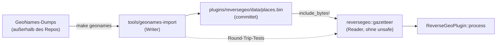

# Tech Spec — Offline-Ortsverzeichnis aus GeoNames für reversegeo (`geonames-gazetteer`)

Setzt das PRD `docs/prd/geonames-gazetteer.md` um. Die Verfassung hat Vorrang; diese Tech Spec darf sie präzisieren, nie lockern. Grundlage ist [ADR 0006](../adr/0006-geonames-gazetteer-names.md), das [ADR 0005](../adr/0005-geonames-gazetteer.md) ersetzt.

## Architektur

**`plugins/reversegeo/src/gazetteer.rs`** (neu, Reader)

- `pub const FORMAT_VERSION: u16 = 1;` und das Format aus dem Abschnitt _Datenmodell_.
- `Gazetteer::parse(bytes: &[u8]) -> Result<Gazetteer<'_>, FormatError>` prüft:
  - Magic, Formatversion und Abschnittslängen gegen die Gesamtlänge;
  - `cells` monoton steigend, letzter Eintrag gleich `n_places`.

  Kosten: O(1) plus O(Zellen) für die Monotonieprüfung, kein Kopieren.

- `Gazetteer::nearest(lat, lon, max_km) -> Option<(Place<'_>, f64)>`:
  - durchsucht die Gitterzellen im Rechteck um den Punkt, das `max_km` sicher umfasst (Breitenspanne `max_km / 111,0` Grad, Längenspanne `max_km / (111,32 · cos φ_max)` Grad, über ±180° umlaufend, an den Polen auf alle Längen begrenzt);
  - misst die Großkreisentfernung (Haversine, Erdradius 6.371 km);
  - liefert den nächsten Ort mit Entfernung ≤ `max_km`. Bei Gleichstand gewinnt der kleinere Index (deterministisch).
- `Place` liefert über Accessoren `city`, `local_city`, `county`, `region`, `local_region`, `country`, `local_country`, `country_code` und `local_language`; jeder als `Option<&str>`.
- `Gazetteer::meta()` liefert den Herkunftstext aus dem Kopf.
- Alle Zugriffe nutzen `u32::from_le_bytes(slice.try_into()?)` auf geprüften Teilbereichen. Es gibt kein `unsafe` und keine Panik bei kaputten Daten; jeder Fehler wird zu `None` oder `FormatError`.
- `pub static PLACES: &[u8] = include_bytes!("../data/places.bin");`

**`plugins/reversegeo/src/lib.rs`**

- `CITIES`, `COUNTRY_BOXES`, `CityRef`, `CountryBox` und `KM_PER_DEGREE` entfallen.
- `offline_lookup` ruft `Gazetteer::parse(PLACES)` und danach `nearest(lat, lon, city_radius_km)` auf.
  - Ein Treffer wird zu `LocationInfo` mit den Feldern des Orts; die Koordinaten und `altitude` bleiben unverändert.
  - Ohne Treffer → `None`. Danach greift der bestehende Weg: online oder leer mit Warnung.
- Lässt sich `places.bin` nicht lesen (`FormatError`), warnt das Plugin einmal je Aufruf (`reversegeo: offline data unusable: …`) und behandelt den Fall wie „kein Treffer“. Erfunden wird nichts.
- `ReverseGeoSettings::city_radius_km`: Standard 25, Bereich `1..=200`.
- Log-Meldung `Resolved via offline GeoNames lookup (<km> km to <city>)` statt „Natural Earth“.

**`tools/geonames-import`** (neu, Workspace-Mitglied, `publish = false`, nur `std` plus die Plugin-Crate als `dev-dependency` für Round-Trip-Tests)

- Aufruf: `geonames-import --input <dir> --output <file> --date <YYYY-MM-DD>`.
- Eingaben im Ordner `<dir>`: `cities1000.txt`, `admin1CodesASCII.txt`, `admin2Codes.txt`, `countryInfo.txt`, `alternateNamesV2.txt`.
- Ablauf:
  1. **`countryInfo.txt`:** ISO-Code, `Country`, erste Sprache aus `Languages` (vor `-`, klein geschrieben) und `geonameid`.
  2. **`admin1CodesASCII.txt` / `admin2Codes.txt`:** Schlüssel `CC.A1` bzw. `CC.A1.A2`, Name und `geonameid`.
  3. **`cities1000.txt`:** Spalten `geonameid`, `name`, `latitude`, `longitude`, `feature code`, `country code`, `admin1 code`, `admin2 code`. `PPLX` wird verworfen.
  4. **`alternateNamesV2.txt`:** in einem Durchlauf nur die Zeilen, deren `geonameid` in 1–3 vorkommt. Verworfen werden Sprachcodes, die nicht aus 2–3 Kleinbuchstaben bestehen (`link`, `post`, `iata`, `wkdt` usw.), sowie Zeilen mit `isHistoric = 1` oder `isColloquial = 1`.
  5. **Namenswahl** (ADR 0006, Punkt 4):
     - **Orte und Verwaltungseinheiten:** erst `isPreferredName = 1`, dann `isShortName = 0`, dann die kleinste `alternateNameId`.
     - **Länder (`local_country`):** erst `isShortName = 1`, dann `isPreferredName = 1`, dann die kleinste `alternateNameId`.
     - **Englisch:** Sprache `en`; ohne Treffer der GeoNames-Name.
     - **Lokal** (`local_city`, `local_region`): erste Landessprache; ohne Treffer der GeoNames-Name. Für `local_country` gibt es keinen Rückfall.
  6. **Schreiben:**
     - Orte sortiert nach (Zelle, `geonameid`);
     - Länder nach ISO-Code, Verwaltungseinheiten nach Schlüssel;
     - Zeichenketten dedupliziert in Reihenfolge des ersten Auftretens.

  Dieselben Eingaben ergeben damit dieselben Bytes.

- Fehlende Spalten, ungültige Zahlen oder fehlende Dateien führen zum Abbruch mit Datei und Zeilennummer. Es wird keine Teil-Datei geschrieben; die Ausgabe entsteht als `<file>.tmp` und wird erst am Ende umbenannt.
- Am Ende meldet das Werkzeug Anzahlen und Dateigröße auf stderr.

**`Makefile`**

- Neues Ziel `geonames`:
  - lädt `cities1000.zip`, `alternateNamesV2.zip`, `admin1CodesASCII.txt`, `admin2Codes.txt` und `countryInfo.txt` von `https://download.geonames.org/export/dump/` nach `$(GEONAMES_DIR)` (Standard `$${TMPDIR:-/tmp}/flagme-geonames`, außerhalb des Repositorys) und entpackt sie;
  - ruft `cargo run --release -p geonames-import -- --input $(GEONAMES_DIR) --output plugins/reversegeo/data/places.bin --date $$(date -u +%F)` auf.
- Die Ziele `release`, `test` und `components` bleiben ohne Netz.

## Schnittstellen

- **`config.yaml`:** Es gibt keinen neuen Schlüssel. `plugins.reversegeo.settings.city_radius_km` ist jetzt die Höchstentfernung zum nächsten Ort (Standard 25, Bereich 1–200; die SDK-Regeln kappen Werte außerhalb mit Warnung).
- **Dokumentmodell und WIT:** unverändert. Felder, die das Verzeichnis nicht kennt, bleiben `None`: `local_country` ohne Namen in der Landessprache, `local_language` bei Ländern ohne Sprachangabe.
- **CLI des Plugins** (`flagme-plugin-reversegeo`): Es nutzt dieselben eingebetteten Daten.

## Datenmodell

`places.bin`, Formatversion 1. Alle Zahlen sind Little Endian. `NONE = 0xFFFF_FFFF` (u32) bzw. `0xFFFF` (u16).

| Abschnitt      | Inhalt                                                                                                                                                                                                                                               | Größe            |
| :------------- | :--------------------------------------------------------------------------------------------------------------------------------------------------------------------------------------------------------------------------------------------------- | :--------------- |
| Kopf (48 Byte) | `magic = "FGPL"`, `version: u16`, `reserved: u16 = 0`, `n_places: u32`, `n_countries: u32`, `n_admin1: u32`, `n_admin2: u32`, `strings_len: u32`, `meta: u32` (String-Referenz), `grid_lat: u16 = 180`, `grid_lon: u16 = 360`, 12 Byte reserviert (0) | 48               |
| Länder         | je `code: [u8; 2]`, `name`, `local`, `lang` (je u32-Referenz)                                                                                                                                                                                        | 14 · n_countries |
| admin1         | je `name`, `local` (u32-Referenzen)                                                                                                                                                                                                                  | 8 · n_admin1     |
| admin2         | je `name` (u32-Referenz)                                                                                                                                                                                                                             | 4 · n_admin2     |
| Zellen         | `(grid_lat · grid_lon + 1)` × u32: erster Ortsindex je Zelle; Zelle = `floor(lat + 90) · 360 + floor(lon + 180)` (geklemmt)                                                                                                                          | 259.204          |
| Orte           | je `lat: i32`, `lon: i32` (1e-5 Grad), `name: u32`, `local: u32`, `country: u16`, `admin1: u16`, `admin2: u32`                                                                                                                                       | 24 · n_places    |
| Zeichenketten  | je LEB128-Länge plus UTF-8; eine Referenz ist der Byte-Offset in diesem Block                                                                                                                                                                        | strings_len      |

Gemessen am Prototyp (Dumps vom 2026-11-27): 162.380 Orte, 3.865 admin1, 47.752 admin2, etwa 201.000 verschiedene Zeichenketten (≈ 2,5 MB). Erwartete Gesamtgröße ≈ 7,1 MB, unter der Grenze von 8 MB aus AC-10. Die tatsächlichen Werte trägt die Umsetzung unter _Messwerte_ nach.

## Umsetzung der Akzeptanzkriterien

| AC    | Umsetzung                                 | Test                                                                                                                        |
| ----- | ----------------------------------------- | --------------------------------------------------------------------------------------------------------------------------- |
| AC-1  | `nearest` + Namensregeln                  | `crates/host/tests/gazetteer_test.rs` `test_ac1_small_towns_offline`                                                        |
| AC-2  | wie AC-1, ohne `PPLX`                     | `test_ac2_border_points_offline`                                                                                            |
| AC-3  | Länder-Rechtecke entfallen                | `test_ac3_no_capital_fallback`                                                                                              |
| AC-4  | `nearest` → `None`, bestehender Rückfall  | `test_ac4_no_place_within_radius`                                                                                           |
| AC-5  | `city_radius_km` als Höchstentfernung     | `test_ac5_city_radius_km`                                                                                                   |
| AC-6  | `CITIES`/`COUNTRY_BOXES` entfallen        | `test_ac6_no_builtin_places`                                                                                                |
| AC-7  | Namenswahl im Werkzeug                    | `tools/geonames-import` `test_ac7_name_rules` (Fixture) plus `gazetteer_test.rs` `test_ac7_names_from_data`                 |
| AC-8  | deterministischer Writer, Versionsprüfung | `tools/geonames-import` `test_ac8_deterministic_and_versioned` plus `plugins/reversegeo` `test_ac8_rejects_unknown_version` |
| AC-9  | Texte in `NOTICE`, README, CHANGELOG      | `gazetteer_test.rs` `test_ac9_attribution`                                                                                  |
| AC-10 | Größe und Laufzeit                        | `gazetteer_test.rs` `test_ac10_size_and_time`                                                                               |

Ältere Tests, die die abgelöste Tabelle festschreiben, werden an ADR 0006 angepasst. Ihre Kriterien-Kennungen bleiben, nur die erwarteten Werte ändern sich:

- `settings_test.rs` `reversegeo_city_radius_km` und der Standardwert-Test: 200 → 25, Berlin über Länder-Rechteck → unaufgelöst;
- `ac_test.rs` (Berlin).

## Sicherheit

- _Strikte Regeln_ 1: Weder Reader noch Writer enthalten `unsafe`. Kaputte Daten führen zu Fehlern, nie zu Panik oder Speicherfehlern.
- _Strikte Regeln_ 2: Es gibt keine fest eingebauten Orte mehr. Jeder Name stammt aus GeoNames für genau diesen Ort, diese Verwaltungseinheit oder dieses Land (ADR 0006).
- _Security_ 1–2: Es gibt keinen neuen Grant. Die Daten sind Teil der Komponente; `reversegeo` liest keine Datei.
- Das Werkzeug läuft nur beim Maintainer. Es liest heruntergeladene Daten und behandelt sie als nicht vertrauenswürdig: Es parst nur, führt nichts aus und begrenzt Längen. Eine Zeichenkette über 65.535 Byte führt zum Abbruch.

## Messwerte

Gemessen am 2026-11-27 auf macOS (Apple Silicon) mit den Dumps vom selben Tag.

| Größe | Wert | Grenze (AC-10) |
| :-- | --: | --: |
| `places.bin` | 7.005.345 Byte (6,68 MiB) | ≤ 8 MiB |
| Orte / ohne `PPLX` verworfen | 162.380 / 9.728 | — |
| Länder / admin1 / admin2 / Zeichenketten | 252 / 3.865 / 47.752 / 205.294 | — |
| Komponente `flagme_plugin_reversegeo.wasm` | 7.402.427 Byte (vorher ≈ 0,39 MB) | — |
| `nearest` (nativ, Release; der Gast nutzt denselben Code) | 40 µs je Zuordnung | ≤ 5 ms |
| `reversegeo` über den Host (Release, ohne Netz, inkl. Instanziierung und Kopie der Daten) | Median 0,73 ms, Maximum 1,04 ms | ≤ 20 ms |
| `flagme-host process` mit `metadata` + `reversegeo`, ohne / mit Komponenten-Cache | 0,19 s / 0,13 s | — |
| `make geonames`, Aufbereitung ohne Download (Release) | 7,5 s | — |

Der Test `test_ac10_size_and_time` prüft die Grenzen im Debug-Build des Hosts. Die Komponenten baut er im Release-Modus; gemessen wurden dort ein Median von 0,77 ms und 58 µs je Zuordnung.

## Offene Punkte

- Keine.
