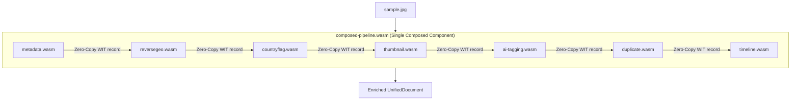

# Pipeline Execution Model 2b — WebAssembly Component Composition

In this execution model, individual WASM plugins are statically composed into a **single, unified WebAssembly component** (`composed-pipeline.wasm`) using Component Model composition tools like [`wac`](https://github.com/bytecodealliance/wac) or `wasm-tools compose`.

---

## Architecture

Instead of passing JSON strings over operating system pipes, composed components communicate directly in linear WebAssembly memory via typed WIT interfaces:



---

## 1. Composition Tooling

Install the bytecode alliance composition tooling:

```bash
cargo install wac-cli
cargo install wasm-tools
```

---

## 2. Defining the Composition Contract (`pipeline.wac`)

Create a composition definition file `pipeline.wac`:

```wac
package wasmgeohost:pipeline;

// Instantiate individual plugin components
let meta = new wasmgeohost:media-plugin { ... };
let geo = new wasmgeohost:reversegeo-plugin { ... };
let flag = new wasmgeohost:countryflag-plugin { ... };

// Route typed records between stages
let enriched_geo = geo.process(meta.process);
let final_doc = flag.process(enriched_geo);

export final_doc;
```

---

## 3. Composing the Pipeline

Compose all compiled plugin components into a single executable component:

```bash
# Compose metadata and geo plugins into a unified component
wac compose \
    --plug target/wasm32-wasip2/release/flagme_plugin_reversegeo.wasm \
    target/wasm32-wasip2/release/flagme_plugin_metadata.wasm \
    -o target/wasm32-wasip2/release/composed_pipeline.wasm
```

Alternatively, with `wasm-tools`:

```bash
wasm-tools compose \
    -c config.yaml \
    target/wasm32-wasip2/release/flagme_plugin_metadata.wasm \
    -o target/wasm32-wasip2/release/composed_pipeline.wasm
```

---

## 4. Invocation Example

Run the composed super-component with a single `wasmtime` command:

```bash
wasmtime run -S cli-exit-with-code \
    --dir Examples::/media \
    target/wasm32-wasip2/release/composed_pipeline.wasm /media/sample.jpg
```

---

## 5. Advantages & Trade-Offs

- **Advantages**:
  - **Highest possible performance**: True zero-copy execution within WebAssembly. No intermediate JSON serialization/deserialization.
  - **Single Artifact**: One `.wasm` file to distribute, verify, and deploy.
  - **Single Sandbox**: Only one Wasmtime engine instance needs to be initialized.
- **Trade-Offs**:
  - Requires static composition step during CI/CD build time.
  - Pipeline order is fixed at composition time rather than dynamically configured via YAML at runtime.
