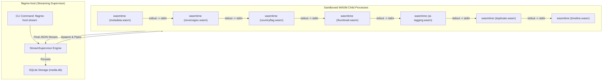

# Pipeline Execution Model 2c — Host Streaming Supervisor

In this execution model, the host engine (`flagme-host`) acts as an active **Subprocess Streaming Supervisor**.

Instead of executing plugins in-process via shared memory, `flagme-host stream` dynamically spawns each plugin as a sandboxed `wasmtime` child process, connects their `stdin` and `stdout` streams, monitors resource consumption, and persists the final result to the SQLite database.

---

## Architecture



---

## 1. How It Works in `flagme-host`

The `StreamSupervisor` ([crates/host/src/stream.rs](../crates/host/src/stream.rs)) manages execution:
1. Spawns Stage 0 (`metadata.wasm`), granting sandboxed filesystem access (`--dir Examples::/media`).
2. Captures Stage 0 `stdout` and pipes it into Stage 1 (`reversegeo.wasm`) via `child.stdin`.
3. Chains through all stages sequentially until Stage 6 (`timeline.wasm`).
4. Verifies non-zero exit codes.
5. Ingests the final `UnifiedDocument` JSON and writes records into `media.db`.

---

## 2. Invocation Example

Run the supervisor streaming pipeline directly:

```bash
cargo run --bin flagme-host -- stream Examples/sample.jpg --config config.yaml
```

### With Sample PNG:
```bash
cargo run --bin flagme-host -- stream Examples/sample.png --config config.yaml
```

### With Sample HEIC:
```bash
cargo run --bin flagme-host -- stream Examples/sample.heic --config config.yaml
```

---

## 3. Output

The supervisor outputs the complete pretty-printed JSON document while logging stage progression:

```json
{
  "id": "cli-doc",
  "file": {
    "path": "/media/sample.jpg",
    "filename": "sample.jpg",
    "size_bytes": 1285,
    "mime_type": "image/jpeg",
    "sha256": "00000000000000005f6ad9232bcc88ed00000000000000005f6ad9232bcc88ed"
  },
  "metadata": {
    "camera_make": "Sony",
    "camera_model": "ILCE-7RM4",
    "lens_model": "FE 24-70mm F2.8 GM",
    "iso": 100,
    "focal_length": 35.0,
    "f_number": 2.8,
    "exposure_time": "1/250"
  },
  "location": {
    "latitude": 52.520008,
    "longitude": 13.404954,
    "city": "Berlin",
    "country": "Germany",
    "country_code": "DE"
  },
  "country": {
    "country_code": "DE",
    "country_name": "Germany",
    "flag_emoji": "🇩🇪"
  },
  "thumbnails": [
    { "size_label": "small", "width": 128 },
    { "size_label": "medium", "width": 512 },
    { "size_label": "large", "width": 1024 }
  ],
  "ai": {
    "tags": [{ "label": "mountain peak", "confidence": 0.91 }],
    "description": "Mountain range under bright sky"
  },
  "duplicate": {
    "sha256": "00000000000000005f6ad9232bcc88ed00000000000000005f6ad9232bcc88ed",
    "phash": "3a8f7b262a2422c5"
  },
  "timeline": {
    "taken_at": "2026-11-25T11:30:31Z",
    "resolution_source": "imported_timestamp_fallback"
  }
}
```

---

## 4. Advantages & Trade-Offs

- **Advantages**:
  - Full OS process isolation between plugins.
  - Automated SQLite database persistence built-in.
  - Dynamic configurability: plugins can be enabled/disabled at runtime via `config.yaml`.
- **Trade-Offs**:
  - Subprocess pipe I/O has slightly higher latency than In-Process Component embedding (`flagme-host process`).
