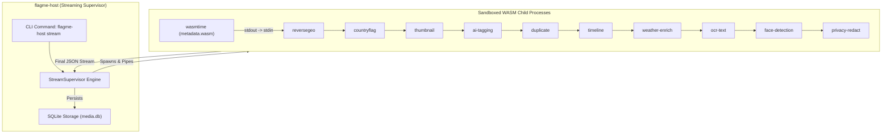

# Pipeline Execution Model 2c — Host Streaming Supervisor

In this execution model, the host engine (`flagme-host`) acts as an active **Subprocess Streaming Supervisor**.

Instead of executing plugins in-process via shared memory, `flagme-host stream` dynamically spawns each plugin as a sandboxed `wasmtime` child process, connects their `stdin` and `stdout` streams, monitors resource consumption, and persists the final result to the SQLite database.

---

## Architecture



---

## 1. How It Works in `flagme-host`

The `StreamSupervisor` ([crates/host/src/stream.rs](../crates/host/src/stream.rs)) manages execution:
1. Spawns Stage 0 (`metadata.wasm`) with the file path as argument and sandboxed filesystem access (`--dir Examples::/media`).
2. Captures Stage 0 `stdout` and pipes it into Stage 1 (`reversegeo.wasm`) via `child.stdin`.
3. Chains through all 11 stages (`StreamSupervisor::default_pipeline()`) up to `privacy-redact.wasm`.
4. Aborts on a non-zero exit code of any stage.
5. Ingests the final `UnifiedDocument` JSON and writes records into `media.db` (`database_path` from `--config`).

Prerequisites: `wasmtime` on the `PATH` and the plugins built with `cargo build --release --target wasm32-wasip2 -p flagme-plugin-<name>` (the supervisor reads `target/wasm32-wasip2/release/flagme-plugin-*.wasm`).

---

## 2. Invocation Example

Run the supervisor streaming pipeline directly:

```bash
cargo run --bin flagme-host -- stream Examples/sample.jpg --config config.yaml
```

### With Sample PNG:
```bash
cargo run --bin flagme-host -- stream Examples/sample.png --config config.yaml
```

### With Sample HEIC:
```bash
cargo run --bin flagme-host -- stream Examples/sample.heic --config config.yaml
```

---

## 3. Output

Real output of `flagme-host stream Examples/sample.jpg --config config.yaml` (2026-11-26, wasmtime 42, sample generated by `Examples/generate_samples.py`). `raw_tags` is shortened to 8 of 43 entries; all other values are unchanged.

```json
{
  "id": "cli-doc",
  "file": {
    "path": "/media/sample.jpg",
    "filename": "sample.jpg",
    "size_bytes": 1664,
    "mime_type": "image/jpeg",
    "sha256": "bad3f144b026ea02ad88a9bb16e4f08ddb5b44dc7f7650aa516ee88ce0c77dc4"
  },
  "metadata": {
    "camera_make": "Sony",
    "camera_model": "ILCE-7RM4",
    "lens_model": "FE 24-70mm F2.8 GM",
    "iso": 100,
    "focal_length": 35.0,
    "f_number": 2.8,
    "exposure_time": "1/250 s",
    "raw_tags": {
      "Exif.Make": "Sony",
      "Exif.Model": "ILCE-7RM4",
      "Exif.LensModel": "FE 24-70mm F2.8 GM",
      "Exif.DateTimeOriginal": "2026-11-25 10:00:00",
      "Exif.GPSLatitude": "52 deg 31 min 12.0288 sec N",
      "Exif.GPSLongitude": "13 deg 24 min 17.8344 sec E",
      "IPTC.Application2.ObjectName": "WASM Geo Sample",
      "XMP.photoshop.City": "Berlin"
    }
  },
  "location": {
    "latitude": 52.52,
    "longitude": 13.4,
    "altitude": 34.0,
    "country": "Germany",
    "country_code": "DE",
    "region": "Berlin",
    "county": "Berlin",
    "city": "Berlin",
    "local_country": "Deutschland",
    "local_region": "Berlin",
    "local_city": "Berlin",
    "local_language": "de"
  },
  "country": {
    "country_code": "DE",
    "country_name": "Germany",
    "flag_emoji": "🇩🇪",
    "continent": "Europe",
    "region": "Western Europe"
  },
  "thumbnails": [
    {
      "size_label": "small",
      "width": 128,
      "height": 128,
      "path": "cache/thumbnails/5bf81873995c2115_128.jpg",
      "cache_key": "5bf81873995c2115"
    },
    {
      "size_label": "medium",
      "width": 512,
      "height": 512,
      "path": "cache/thumbnails/1892c2620f6e0096_512.jpg",
      "cache_key": "1892c2620f6e0096"
    },
    {
      "size_label": "large",
      "width": 1024,
      "height": 1024,
      "path": "cache/thumbnails/5c8b3abdf28913f3_1024.jpg",
      "cache_key": "5c8b3abdf28913f3"
    }
  ],
  "duplicate": {
    "sha256": "bad3f144b026ea02ad88a9bb16e4f08ddb5b44dc7f7650aa516ee88ce0c77dc4",
    "phash": "0000000000004eb6"
  },
  "timeline": {
    "taken_at": "2026-11-25T10:00:00Z",
    "imported_at": "2026-11-26T09:47:55.790248Z",
    "resolution_source": "exif_datetime_original"
  },
  "weather": {
    "temperature": -2.1,
    "condition": "Snow Fall",
    "wmo_code": 71,
    "icon_emoji": "❄️",
    "humidity_percent": 85,
    "precipitation_mm": 1.8,
    "is_day": true
  },
  "privacy": {
    "is_redacted": true,
    "faces_redacted_count": 0,
    "license_plates_redacted_count": 0,
    "original_gps_fuzzed": true,
    "applied_rules": [
      "fuzzed_gps_precision_2_decimals"
    ]
  },
  "custom": {}
}
```

What the values show:

| Field | Source |
| :--- | :--- |
| `metadata`, `timeline` | Real EXIF/IPTC/XMP of `sample.jpg` (`exif_datetime_original`). |
| `location` | GPS from EXIF, resolved offline (Natural Earth); rounded to 2 decimals by `privacy-redact` (`fuzzed_gps_precision_2_decimals`). |
| `country` | Offline ISO-3166 table. |
| `ai`, `ocr`, `faces` | Absent: these plugins have no engine ([ADR 0002](adr/0002-plugins-without-engine-no-output.md)). |
| `duplicate`, `file.sha256` | **Not the file hash.** Only Stage 0 gets `--dir`; `duplicate` cannot read the file and hashes the path string instead (real SHA256 of `sample.jpg`: `3cc6a7aa…`). |
| `thumbnails` | **No files exist.** Without file access `thumbnail` can neither read the source nor write into the sandbox; the entries list the requested sizes, not measured ones, and the paths point to files that were not created. |
| `weather` | **Estimated, not measured.** Without `http` the `weather-enrich` offline fallback computes a climatological estimate. |

### Known limitations of the streaming mode

- Only Stage 0 receives filesystem access; later stages cannot read the image ([#25](https://github.com/Zheng-Bote/wasm_geo-host/issues/25), [#30](https://github.com/Zheng-Bote/wasm_geo-host/issues/30)).
- The pipeline ignores `enabled` and `settings` from `config.yaml`; every stage runs with its default settings.
- The document id is always `cli-doc`; `file.path` is the sandbox path (`/media/…`).
- Log messages of the plugins are not shown (the plugin CLIs have no log output).

---

## 4. Advantages & Trade-Offs

- **Advantages**:
  - Full OS process isolation between plugins.
  - Automated SQLite database persistence built-in.
  - Plugins run as real `wasm32-wasip2` binaries under `wasmtime`.
- **Trade-Offs**:
  - Subprocess pipe I/O has higher latency than in-process execution (`flagme-host process`, currently native plugins — see [#30](https://github.com/Zheng-Bote/wasm_geo-host/issues/30)).
  - `enabled`, `settings` and capabilities from `config.yaml` are not applied (see §3).
