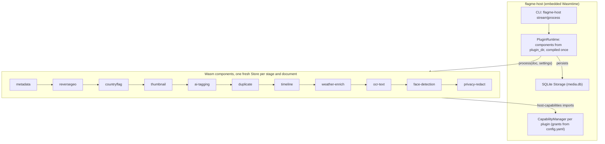

# Pipeline Execution Model 2c — `flagme-host stream`

`flagme-host stream` runs the configured pipeline on the **embedded Wasmtime runtime** of the host, exactly like `flagme-host process` ([ADR 0003](adr/0003-wasm-component-execution.md)). Every stage is a Wasm component (`media-plugin` world, [`wit/media-plugin.wit`](../wit/media-plugin.wit)) and runs in its own `Store`; the final `UnifiedDocument` is written to SQLite and printed on stdout.

Until #30, `stream` spawned the external `wasmtime` CLI per stage and piped JSON between the processes; capabilities, `enabled` and `settings` did not apply there. That supervisor is gone.

---

## Architecture



---

## 1. How It Works

1. The host reads `config.yaml` and loads every **enabled** plugin of `pipeline` from its component file: `path` of the plugin, else `<plugin_dir>/flagme_plugin_<name>.wasm` (`-` becomes `_`). A missing or invalid component stops the host with an error naming the file; there is no native fallback.
2. For each stage the host creates a fresh `Store` with:
   - a WASI context **without ambient authority** — no preopened directories, no environment variables, no stdin, no sockets; only clocks, random and stderr;
   - the plugin's `CapabilityManager`: `fs-read`, `fs-write`, `fs-modified`, `http-get`, `kv-*`, `secret-get` succeed only with the grant in `config.yaml`;
   - `resource_limits.max_memory_bytes` (linear memory) and `resource_limits.timeout_ms` (epoch interruption, 10 ms ticks).
3. It calls `process(doc, settings)` with the plugin's `settings` from `config.yaml`.
4. A failing stage (plugin error, trap, exceeded limit) fails the document with an error naming the stage; `watch` continues with the next file.
5. The final document is written to `media.db` (`database_path`) and printed as JSON.

Prerequisite: the plugin components, built with

```bash
cargo build --release --target wasm32-wasip2 --lib --features component \
  -p flagme-plugin-metadata -p flagme-plugin-reversegeo -p flagme-plugin-countryflag \
  -p flagme-plugin-thumbnail -p flagme-plugin-ai-tagging -p flagme-plugin-duplicate \
  -p flagme-plugin-timeline -p flagme-plugin-weather-enrich -p flagme-plugin-ocr-text \
  -p flagme-plugin-face-detection -p flagme-plugin-privacy-redact
```

`plugin_dir` in `config.yaml` points at `target/wasm32-wasip2/release`. No `wasmtime` CLI is needed.

---

## 2. Invocation Example

```bash
cargo run --release --bin flagme-host -- stream Examples/sample.jpg --config config.yaml
cargo run --release --bin flagme-host -- stream Examples/sample.png --config config.yaml
cargo run --release --bin flagme-host -- stream Examples/sample.heic --config config.yaml
```

---

## 3. Output

Real output of `flagme-host stream Examples/sample.jpg --config config.yaml` (2026-11-26, release build, plugins as Wasm components after #30, sample generated by `Examples/generate_samples.py`). `raw_tags` is shortened to 8 of 34 entries; all other values are unchanged.

```json
{
  "id": "3f12502733adb127",
  "file": {
    "path": "Examples/sample.jpg",
    "filename": "sample.jpg",
    "size_bytes": 1664,
    "mime_type": "image/jpeg",
    "sha256": "3cc6a7aa46e739568eccdc98b09c8760aee2b3053dce47776278a8a85975bf0e"
  },
  "metadata": {
    "camera_make": "Sony",
    "camera_model": "ILCE-7RM4",
    "lens_model": "FE 24-70mm F2.8 GM",
    "iso": 100,
    "focal_length": 35.0,
    "f_number": 2.8,
    "exposure_time": "1/250 s",
    "raw_tags": {
      "Exif.Make": "Sony",
      "Exif.Model": "ILCE-7RM4",
      "Exif.LensModel": "FE 24-70mm F2.8 GM",
      "Exif.DateTimeOriginal": "2026-11-25 10:00:00",
      "Exif.GPSLatitude": "52 deg 31 min 12.0288 sec N",
      "Exif.GPSLongitude": "13 deg 24 min 17.8344 sec E",
      "IPTC.Application2.ObjectName": "WASM Geo Sample",
      "XMP.photoshop.City": "Berlin"
    }
  },
  "location": {
    "latitude": 52.52,
    "longitude": 13.4,
    "altitude": 34.0,
    "country": "Germany",
    "country_code": "DE",
    "region": "Berlin",
    "county": "Berlin",
    "city": "Berlin",
    "local_country": "Deutschland",
    "local_region": "Berlin",
    "local_city": "Berlin",
    "local_language": "de"
  },
  "country": {
    "country_code": "DE",
    "country_name": "Germany",
    "flag_emoji": "🇩🇪",
    "continent": "Europe",
    "region": "Western Europe"
  },
  "thumbnails": [
    {
      "size_label": "small",
      "width": 64,
      "height": 48,
      "path": "cache/thumbnails/aad58983bf531312_128.jpg",
      "cache_key": "aad58983bf531312"
    },
    {
      "size_label": "medium",
      "width": 64,
      "height": 48,
      "path": "cache/thumbnails/6e982c5779c61d3b_512.jpg",
      "cache_key": "6e982c5779c61d3b"
    },
    {
      "size_label": "large",
      "width": 64,
      "height": 48,
      "path": "cache/thumbnails/6c2140244b0b7f61_1024.jpg",
      "cache_key": "6c2140244b0b7f61"
    }
  ],
  "duplicate": {
    "sha256": "3cc6a7aa46e739568eccdc98b09c8760aee2b3053dce47776278a8a85975bf0e",
    "phash": "0000000000000000"
  },
  "timeline": {
    "taken_at": "2026-11-25T10:00:00Z",
    "imported_at": "2026-11-26T15:47:04.899255Z",
    "modified_at": "2026-11-26T09:59:37Z",
    "resolution_source": "exif_datetime_original"
  },
  "weather": {
    "temperature": 1.0,
    "condition": "Overcast",
    "wmo_code": 3,
    "icon_emoji": "☁️",
    "humidity_percent": 68,
    "precipitation_mm": 0.0,
    "is_day": true
  },
  "privacy": {
    "is_redacted": true,
    "faces_redacted_count": 0,
    "license_plates_redacted_count": 0,
    "original_gps_fuzzed": true,
    "applied_rules": [
      "fuzzed_gps_precision_2_decimals"
    ]
  },
  "custom": {}
}
```

What the values show:

| Field | Source |
| :--- | :--- |
| `id` | First 16 hex digits of the SHA-256 of the given path. |
| `metadata`, `timeline.taken_at` | Real EXIF/IPTC/XMP of `sample.jpg` (`exif_datetime_original`). |
| `location` | GPS from EXIF, resolved offline (Natural Earth); rounded to 2 decimals by `privacy-redact` (`fuzzed_gps_precision_2_decimals`). |
| `country` | Offline ISO-3166 table. |
| `file.sha256`, `duplicate`, `thumbnails` | Read and written through the `filesystem` capability. `phash` is the dHash of the decoded pixels; the sample image is a flat colour field, hence all zeros. |
| `timeline.modified_at` | `fs-modified` of the file (differs per checkout). |
| `weather` | Live request to the Open-Meteo archive API through the `http` capability; absent without network. |
| `ai`, `ocr`, `faces` | Absent: these plugins have no engine and are disabled ([ADR 0002](adr/0002-plugins-without-engine-no-output.md)). `privacy-redact` therefore warns that faces were not redacted. |

---

## 4. Trade-Offs

- **Advantages**: one sandboxed execution path for `process`, `watch`, `serve` and `stream`; capabilities, settings and resource limits apply everywhere; no external `wasmtime` binary.
- **Trade-offs**: components are compiled at every host start (≈ 1 s for all 11 in a release build); a compilation cache is a later extension. Limits apply globally (`resource_limits`), not per plugin.
